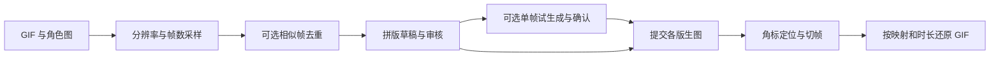

# GIF Character Replacer

把 GIF 拆成完整显示帧，按成本预算拼成多版，通过兼容 OpenAI Images Edits 的接口替换角色，再切回帧并还原播放时序。提供局域网 Web 测试台和 TypeScript CLI。

**实验性项目。** 模型可能改变细微动作、表情或背景；拼版预览和明确提示词不能保证生成结果完全遵守约束。默认不会自动重发生图请求。



## 功能

- 根据上传 GIF 的尺寸、帧数和时长生成采样选项，支持完整时间轴的运动分析与智能抽帧建议。
- 按画布范围动态规划每版容量，提交前预览全部拼版；每版显示输入图、返回图、状态及实际提示词。
- 使用四角标记测量切图位置，处理部分供应商的尺寸和颜色偏差，并保留失败响应供本地恢复。
- 全局生图并发默认 **2**，可设 **1–120**；支持本地重切、单版重新生图和继续剩余任务。
- 浏览器保存自定义 provider；服务端 provider 列表通过独立 secret 解锁，仅展示域名和端口。
- 可选实验：高度相似帧共用代表帧结果；先确认一帧效果，再让所有版使用同一外观参考。
- 保留所选时间轴的逐帧时长、总时长和循环计数，记录草稿哈希、重试历史和最终帧来源。

减少待编辑帧不一定减少收费版图数；实际费用由供应商决定，界面显示的是预计请求图片数量。

## 快速开始

需要 **Node.js ≥20.19**，建议 Node.js 22/24 LTS。无需 Python、GPU 或本地模型。FFmpeg 仅用于可选的独立解码验证。

下载或克隆本仓库后，在项目目录运行：

```bash
npm ci
npm run web
```

浏览器打开 <http://localhost:3087>。默认监听 `0.0.0.0:3087`，也可以通过本机局域网地址访问。上传自己的 GIF 和角色参考图即可准备离线草稿，**无需 API Key**。

准备生图时，在页面顶部展开 **生图 Provider**，填写供应商的 Base URL、API Key 和模型名，并保存到浏览器。审核草稿后点击 Submit 才会发送整段生图请求；“试生成所选帧”按钮会单独发送 1 张请求。

Base URL 通常以 `/v1` 结束，不要填写整个 `/images/edits` 地址。模型名称、支持的尺寸和质量档位请以所用供应商为准。接口需要接受多张参考图，并返回单张 base64 PNG；本项目不会假定所有兼容接口的行为一致。

## 服务端 Provider

只使用浏览器自定义 provider 时，不必配置 `.env`。需要共享服务端 provider 时：

```bash
cp .env.example .env
```

在 `.env` 中填写：

```dotenv
OPENAI_BASE_URL=https://your-provider.example/v1
OPENAI_API_KEY=填写供应商密钥
OPENAI_IMAGE_MODEL=填写供应商模型名
OPENAI_IMAGE_QUALITY=medium
OPENAI_IMAGE_TIMEOUT_MS=300000

GIF_LAB_PROVIDER_SECRET=自行设置的列表访问密钥
GIF_LAB_PROVIDERS='[{"id":"default","envPrefix":"OPENAI"}]'
```

在页面输入 `GIF_LAB_PROVIDER_SECRET` 解锁列表，再选择服务端 provider。此 secret 只保护服务端列表及使用权限，**不是测试台登录密码**。服务端 API Key 不返回浏览器；浏览器自定义 API Key 保存在当前站点的 `localStorage`，可编辑或删除。

多 provider 配置、提交与重试行为详见 [Web 操作说明](docs/web-lab.md)。

## 数据与运行参数

| 环境变量 | 默认值 | 说明 |
| --- | --- | --- |
| `GIF_LAB_HOST` | `0.0.0.0` | HTTP 监听地址 |
| `GIF_LAB_PORT` | `3087` | HTTP 端口 |
| `GIF_LAB_DATA_DIR` | `~/experiments/YYYY-MM-DD/gif-character-replacer-web` | 日期按 Asia/Shanghai 计算；目录位于当前用户 home 下 |

这些启动参数通过进程环境传入。长期使用时固定数据目录，避免跨日期重启后打开另一个目录：

```bash
export GIF_LAB_DATA_DIR="$HOME/experiments/2026-10-18/gif-character-replacer-web"
npm run web
```

目录中保存上传素材、输入快照、草稿、供应商响应、切图结果和历史成品。实际 `.env`、用户素材、构建产物和本地实验记录均不纳入 Git。重启时未完成任务会标记为中断，不会自动重新发送图片请求。

测试台面向本机和可信局域网，任务与图片页面没有登录门槛。部署边界和凭据处理见 [SECURITY.md](SECURITY.md)。

## CLI

```bash
npm run cli -- --help

# 不调用生图接口的拆帧、拼版、切帧与重建验证
npm run cli -- roundtrip --input ./materials/gifs/example.gif \
  --out /tmp/gif-character-replacer/demo-001
```

输出目录必须是新目录，避免覆盖已有素材或请求记录。其他命令见 [CLI 使用说明](docs/cli.md)。

## 开发与测试

```bash
npm run typecheck
npm test
npm run build
```

测试使用合成素材和模拟供应商，不需要真实密钥，也不会产生生图费用。GitHub Actions 配置覆盖 Node.js 22/24；本地验证与远程 CI 结果应分别查看。

目录：`src/` 为处理链和 HTTP 服务，`web/` 为浏览器界面，`test/` 为回归测试。欢迎按 [CONTRIBUTING.md](CONTRIBUTING.md) 提交问题或改进。

## 已知限制

- Web 生图流程当前只接受不透明显示帧，不能自动抠图或给透明 GIF 选择底色；原生离线处理另有透明帧支持。
- GIF 最大 100 MiB，单次解码 RGBA 数据上限 512 MiB。部分特殊 GIF 控制块会明确拒绝处理。
- 去重属于保守近似算法，可能漏掉可复用画面，也可能削弱细微动作；默认关闭。
- 共同参考有助于约束外观，但不能保证跨版姿态、表情和背景完全一致。
- 上游 504 不代表一定没有生成；没有拿到图片时应核对供应商结果后再决定重试。提高本地超时不会解除上游网关限制。
- GIF 编码可能进行颜色量化，文件不保证比原图更小。

## 许可证

项目采用 [MIT License](LICENSE)。改编的第三方代码及其许可证见 [THIRD_PARTY_NOTICES.md](THIRD_PARTY_NOTICES.md)。用户素材、供应商服务与生成内容的权利不由本项目许可证授予。
